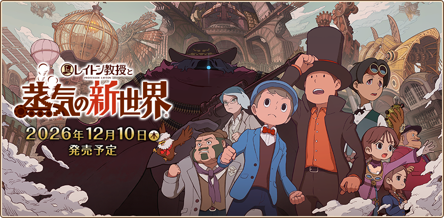
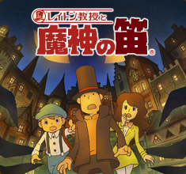
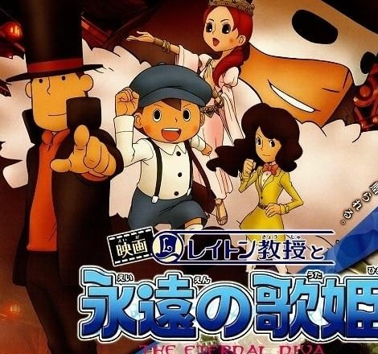
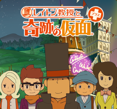
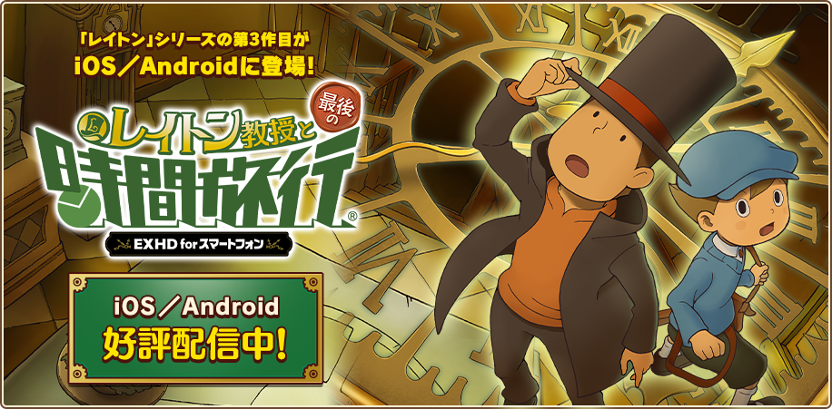

<!-- _class: lead -->
<!-- _header: "" -->

# レイトン教授シリーズのすすめ

---

<!-- _footer: '©LEVEL-5 Inc.' -->

## 新作が出る！

- ナゾを解きながら事件を追うADV
- 『蒸気の新世界』
  - **2026/12/10 発売**
  - Switch 2 / Switch / PS5 / Steam
- 本編は **約13年ぶり**

---

<!-- _class: timeline -->
<!-- _footer: '©LEVEL-5 Inc.' -->

## 発売順

1. 
   **2007**
   ① 不思議な町
   `DS / スマホ`
1. 
   **2007**
   ② 悪魔の箱
   `DS / スマホ`
1. 
   **2008**
   ③ 最後の時間旅行
   `DS / スマホ`
1. 
   **2009**
   ④ 魔神の笛
   `DS`
1. 
   **2009**
   永遠の歌姫
   （映画）
1. 
   **2011**
   ⑤ 奇跡の仮面
   `3DS`
1. 
   **2013**
   ⑥ 超文明Aの遺産
   `3DS`
1. 
   **2026**
   ⑦ 蒸気の新世界
   `Switch 2 / Switch`
   `PS5 / Steam`

**⇒ 本編は約13年ぶり！**

---

<!-- _class: timeline -->
<!-- _footer: '©LEVEL-5 Inc.' -->

## 時系列順だとこうなる

1. 
   **1**
   ④ 魔神の笛
   ルークと出会う
1. 
   **2**
   永遠の歌姫
   （映画）
   一部本編に関係
1. 
   **3**
   ⑤ 奇跡の仮面
1. 
   **4**
   ⑥ 超文明Aの遺産
1. 
   **5**
   ① 不思議な町
1. 
   **6**
   ② 悪魔の箱
1. 
   **7**
   ③ 最後の時間旅行
1. 
   **8**
   ⑦ 蒸気の新世界
   ③の1年後

**⇒ ④〜⑥は①〜③の前日譚。新作は『最後の時間旅行』の1年後の話**

---

<!-- _footer: '©LEVEL-5 Inc.' -->

## 一番のおすすめ

### 『最後の時間旅行』

- シリーズ最高傑作と言われている
  - レイトン教授の壮絶な過去の一部が分かる
- **新作の直前の話** かつ1作完結で始めやすい
- **スマホで遊べる**
  - iOS / Android の買い切り **2,000円**
  - ナゾ1問ずつ、すき間時間に

---

<!-- _class: thanks -->

# ご清聴ありがとうございました

- 町の人、ナゾを出すのが当たり前だと思っている
- ストーリーに関係ないナゾの方が多い気がする
- 隠されたナゾってなんやねん
- クリア後のおまけのナゾが結構ガチ
- 子ども向けの見た目なのに、オチは毎回ぶっ飛んでいる
- でも、レイトンが冷静に解説してるからそんなもんかとなる
- レイトンの過去、壮絶すぎやろ……
- レイトン教授のテーマが神BGM。クライマックスで流れるのが激熱
- 結論：**全部遊んでほしい**
