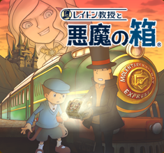
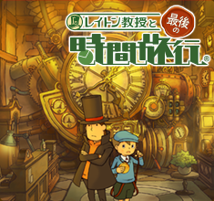
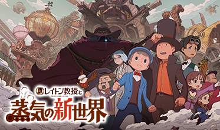

<!-- _class: lead -->
<!-- _header: "" -->

# レイトン教授シリーズのすすめ

---

<!-- _footer: '©LEVEL-5 Inc.' -->

## 新作が出る！

- 『蒸気の新世界』
  - **2026/12/10 発売**
  - Switch 2 / Switch / PS5 / Steam
- 本編は **約13年ぶり**
- 『最後の時間旅行』の1年後の話

⇒ シリーズをおさらい

---

<!-- _class: timeline -->
<!-- _footer: '©LEVEL-5 Inc.' -->

## 発売順

1. 
   **2007**
   ① 不思議な町
1. 
   **2007**
   ② 悪魔の箱
1. 
   **2008**
   ③ 最後の時間旅行
1. 
   **2009**
   ④ 魔神の笛
1. **2009**
   永遠の歌姫
   （映画）
1. 
   **2011**
   ⑤ 奇跡の仮面
1. 
   **2013**
   ⑥ 超文明Aの遺産
1. 
   **2026**
   ⑦ 蒸気の新世界

**⇒ 本編は約13年ぶり！**

---

## 時系列順だとこうなる

| 時系列 | タイトル | |
| --- | --- | --- |
| 1 | ④ 魔神の笛 | ルークと出会う |
| 2 | 🎬 永遠の歌姫 | 映画もちゃんと本編の一部 |
| 3 | ⑤ 奇跡の仮面 | |
| 4 | ⑥ 超文明Aの遺産 | |
| 5 | ① 不思議な町 | |
| 6 | ② 悪魔の箱 | |
| 7 | ③ 最後の時間旅行 | |
| 8 | ⑦ 蒸気の新世界 | ③の1年後 |

**⇒ ④〜⑥は①〜③の前日譚。新作は③の続き**

---

<!-- _footer: '©LEVEL-5 Inc.' -->

## 一番のおすすめ

### 『最後の時間旅行』

- 初期三部作の完結編で話が最高
- **新作の直前の話** で予習にぴったり
- **スマホで遊べる**
  - iOS / Android の買い切り
  - ナゾ1問ずつ、すき間時間に

---

## まとめ

- 12/10に13年ぶりの本編新作『蒸気の新世界』が出る
- 時系列は ④→🎬→⑤→⑥→①→②→③→⑦
- 新作の前に **『最後の時間旅行』をスマホで** 遊んでおくのがおすすめ
